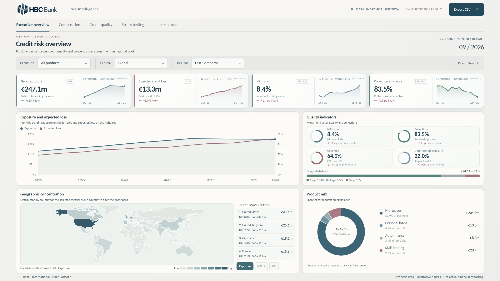
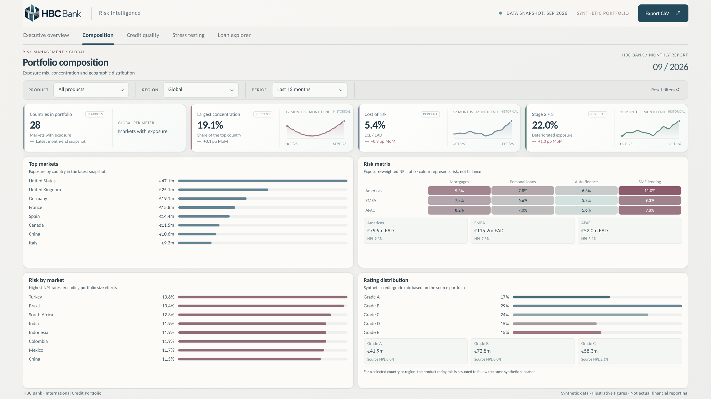
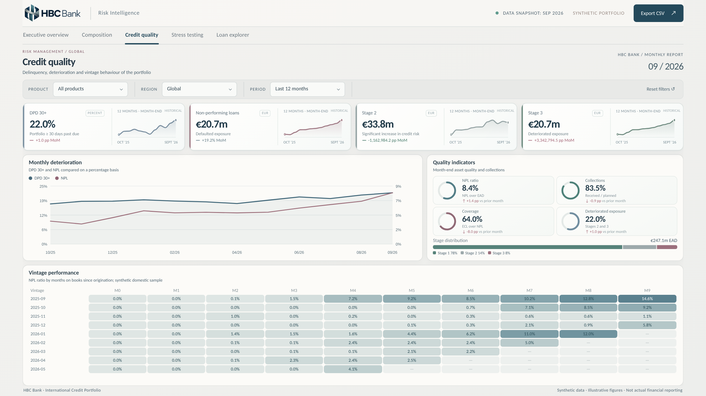
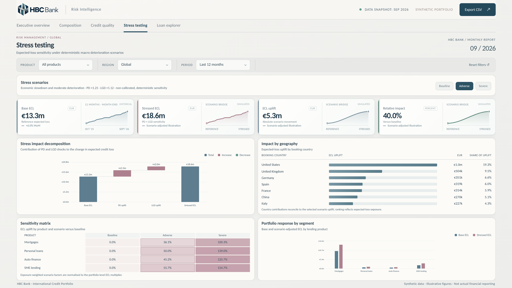
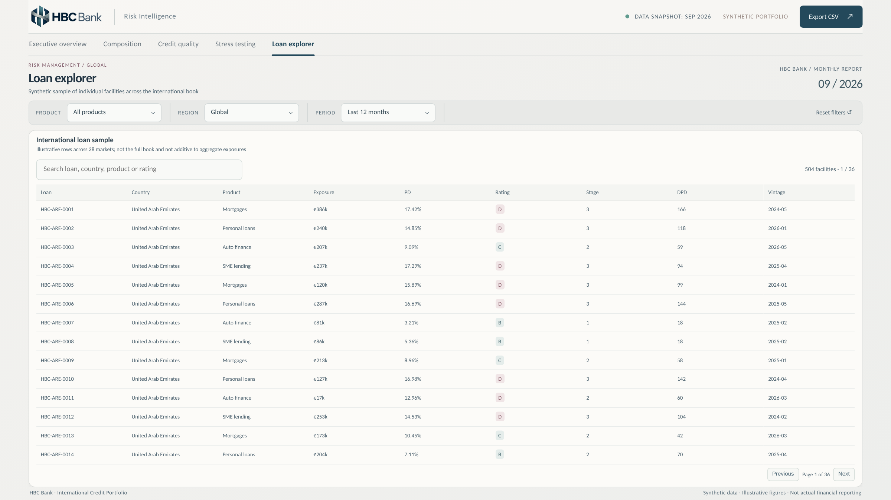

<div align="left">
  
</div>

# HBC Bank | Global Credit Risk Intelligence

**An end-to-end credit risk analytics case study: from synthetic portfolio data and semantic modeling to decision-ready reporting in Power BI and an interactive web experience.**

[**Explore the live dashboard**](https://eliasgitch.github.io/hbc-bank-credit-risk-intelligence/) · [**Power BI project**](powerbi/BANKRISK.pbip) · [**Power BI custom visual**](powerbi-custom-visual/HBC_Bank_Credit_Risk_v1_0_3.pbiviz)

> **Demo project.** HBC Bank is a fictional financial institution. All portfolio records, customer examples, risk assumptions, and results are synthetic. This project is not investment advice, a regulatory risk model, or a representation of any real bank.

---

## Executive overview

HBC Bank is designed as a realistic, international credit risk monitoring workspace. It brings together portfolio exposure, asset quality, expected credit loss, geographic concentration, cash collections, and scenario sensitivity in a consistent analytical experience.

The goal is not simply to build attractive charts: it is to demonstrate how **data modeling, metric definitions, analytical engineering, and product-oriented BI design** can work together to support credit risk decisions.

[](assets/hbc-overview.png)

*Executive overview — exposure and expected-loss trends, asset quality, collections, geographic concentration, and product mix. Click to enlarge.*

## Explore the five analytical workspaces

| Portfolio composition | Credit quality |
|:---:|:---:|
| [](assets/hbc-composition.png) | [](assets/hbc-credit-quality.png) |
| Geographic and product concentration, regional risk matrix, ratings distribution | Delinquency evolution, NPL and ECL coverage, stage migration indicators, vintage analysis |

| Stress testing | Loan explorer |
|:---:|:---:|
| [](assets/hbc-stress-testing.png) | [](assets/hbc-loan-explorer.png) |
| Baseline / Adverse / Severe scenarios, PD–LGD impact bridge, country-level uplift and segment sensitivity | Searchable and paginated synthetic facility sample with risk characteristics |

## Dataset at a glance

| Dimension | Coverage |
|---|---|
| Geography | **28** synthetic country markets |
| History | **24** monthly reporting periods |
| Lending segments | **4** products: mortgages, personal loans, auto finance, and SME lending |
| International aggregate fact | **2,688** month × country × product observations |
| Facility explorer | **504** illustrative loan records |
| Reference snapshot | **September 2026** |

The global portfolio is allocated across countries using transparent synthetic assumptions and reconciled to the underlying aggregate portfolio. **The loan explorer is an illustrative sample and must not be summed to reconcile against the aggregate exposure**.

## Analytical capabilities

**01 / Executive overview** — Track exposure at default (EAD), expected credit loss (ECL), non-performing loans (NPL), collections, concentration, and changes over time. Explore the country-level choropleth and product mix.

**02 / Composition** — Assess concentrations by country, region, and lending product; identify relative risk differences across segments; and inspect rating distributions.

**03 / Credit quality** — Analyze DPD 30+, NPL exposure, ECL coverage, Stage 2 and Stage 3 balances, deterioration patterns, and vintage-level delinquency behavior.

**04 / Stress testing** — Compare **Baseline**, **Adverse**, and **Severe** conditions through deterministic PD/LGD multipliers. The scenario waterfall reconciles the starting ECL, incremental PD effect, incremental LGD effect, and stressed ECL; the country and product views explain where uplift is concentrated.

**05 / Loan explorer** — Navigate a synthetic facility-level sample with geography, product, exposure, probability of default, rating, stage, days past due, and origination vintage.

Dashboard controls support product, region, and reporting-period filtering, plus contextual country selection and CSV export where applicable.

## Technical architecture

```text
Synthetic portfolio source & risk assumptions
                 │
                 ▼
     Data preparation and validation
                 │
                 ▼
  Global portfolio allocation / snapshots
                 │
       ┌─────────┴───────────┐
       ▼                     ▼
 Power BI semantic model   Embedded web demo dataset
 (PBIP / TMDL / DAX)       (HTML / CSS / JavaScript)
       │                     │
       ▼                     ▼
 Custom Power BI visual    Interactive browser dashboard
 (14 bound data roles)     (self-contained / offline-capable)
```

### Semantic model and Power BI

The Power BI project uses **PBIP / TMDL** for a source-readable report and semantic model. Its international analytical layer includes:

- `FactCountryMonth` — monthly exposure and risk balances at **country × product × month** grain.
- `DimCountry` — geographic attributes and regional grouping.
- **Global DAX measures** — exposure, ECL, NPL, arrears, Stage 2 / Stage 3, scheduled receipts, collected cash, and related KPIs.
- A purpose-built **Power BI custom visual** that renders the HBC Bank interface and consumes the semantic model through **14 field roles** spanning time, geography, products, and measures.

The source PBIP currently retains `BANKRISK` in its internal project filenames for compatibility; the business-facing product is **HBC Bank**.

### Metric methodology

| Metric | Analytical definition |
|---|---|
| Gross exposure | Sum of outstanding exposure in the selected perimeter |
| NPL ratio | Non-performing exposure / gross exposure |
| ECL | Sum of expected credit loss amounts |
| ECL coverage | ECL / non-performing exposure |
| DPD 30+ | Exposure with 30+ days past due / gross exposure |
| Stage 2 + 3 share | Stage 2 and Stage 3 exposure / gross exposure |
| Collections ratio | Cash received / cash scheduled |
| Stress ECL | Baseline ECL adjusted by scenario-specific PD and LGD sensitivities |

Ratios should be recalculated from their underlying **sums**, rather than averaged across countries or lending products. Scenario assumptions are **illustrative sensitivity tests**, not IFRS 9 forecasts or independently calibrated PD/LGD models.

## Technology stack

| Layer | Technologies and concepts |
|---|---|
| Analytics and semantic layer | Power BI Desktop, DAX, Power Query (M), PBIP, TMDL |
| Modeling | Dimensional modeling, explicit measure definitions, fact grain, geographic segmentation |
| Dashboard engineering | TypeScript/JavaScript-style application logic, HTML, CSS, SVG, responsive layouts |
| Distribution | Power BI custom visual (`.pbiviz`), self-contained web application, GitHub Pages |
| Development workflow | Git, GitHub, programmatic validation and browser rendering checks |

## Run locally

**Browser experience**

1. Clone or download the repository.
2. Open `index.html` in Chrome or Edge.
3. Explore the five sections, filters, stress scenarios, and loan explorer. No API keys or backend are required for the public demo.

**Power BI experience**

1. Open `powerbi/BANKRISK.pbip` using a compatible Power BI Desktop version.
2. If Power BI requests the custom visual, import `powerbi-custom-visual/HBC_Bank_Credit_Risk_v1_0_3.pbiviz`.
3. Open **HBC Bank Dashboard** and verify the model fields are assigned to the visual.

The standalone browser demo uses its **own bundled synthetic data**. The Power BI custom visual is a separate implementation **bound to Power BI semantic-model fields**; publishing the website does not connect the browser demo to a live Power BI dataset.

## Engineering notes and limitations

- All data is **fictional**, with deterministic assumptions for the geographic allocation and stress sensitivities.
- The 504-row loan explorer is a presentation dataset, not a customer-level accounting ledger.
- Geographic maps are for contextual portfolio analysis; coverage is limited by the bundled boundary geometries.
- This is a portfolio engineering demonstration, **not a regulatory capital engine or a production credit underwriting system**.
- The `.pbiviz` is provided as a compiled visual for the report; the repository does not claim that the dashboard consists exclusively of native Power BI visuals.

---

### Author

**Elías Chafih Meddah** · Senior BI & Analytics Engineer  
[GitHub](https://github.com/eliasgitch) · [Project repository](https://github.com/eliasgitch/hbc-bank-credit-risk-intelligence)

<sub>HBC Bank is a fictional brand used solely for this independent portfolio project. All figures shown are illustrative.</sub>
